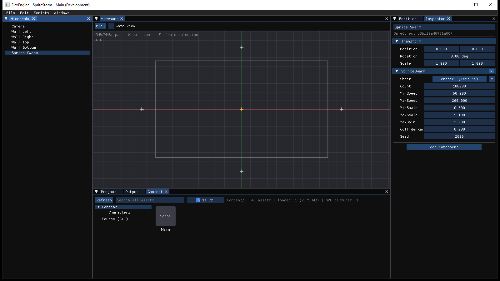
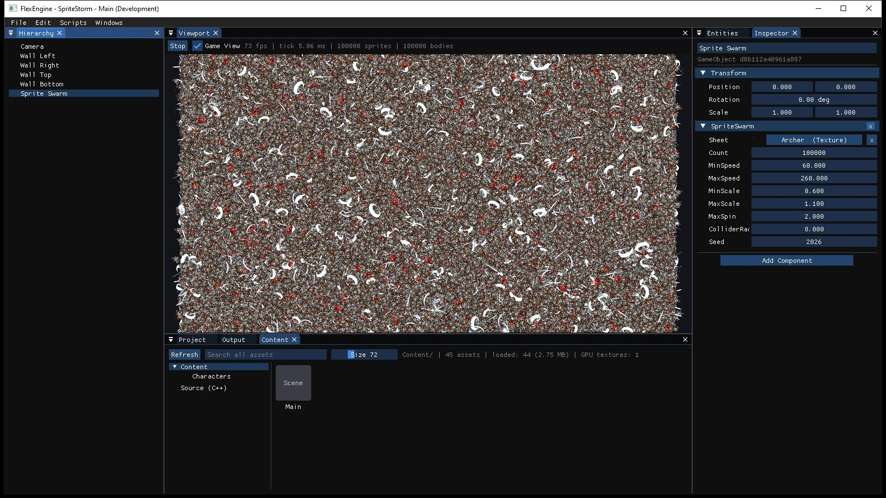
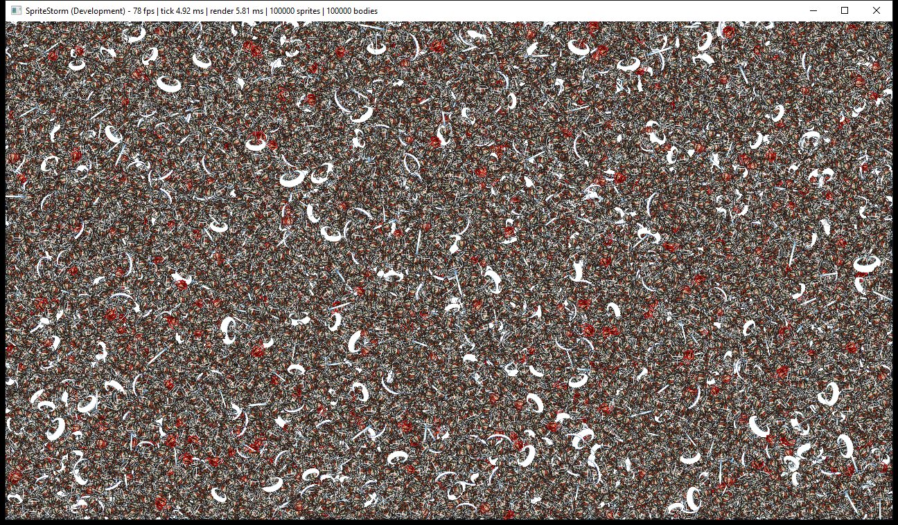
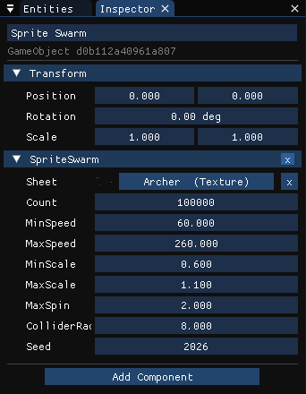
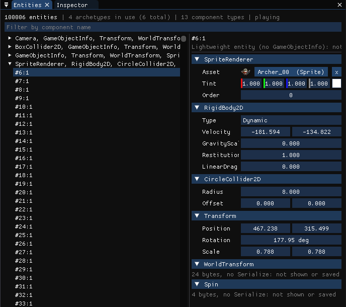
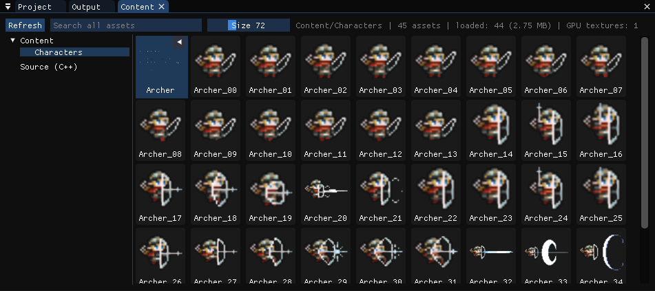
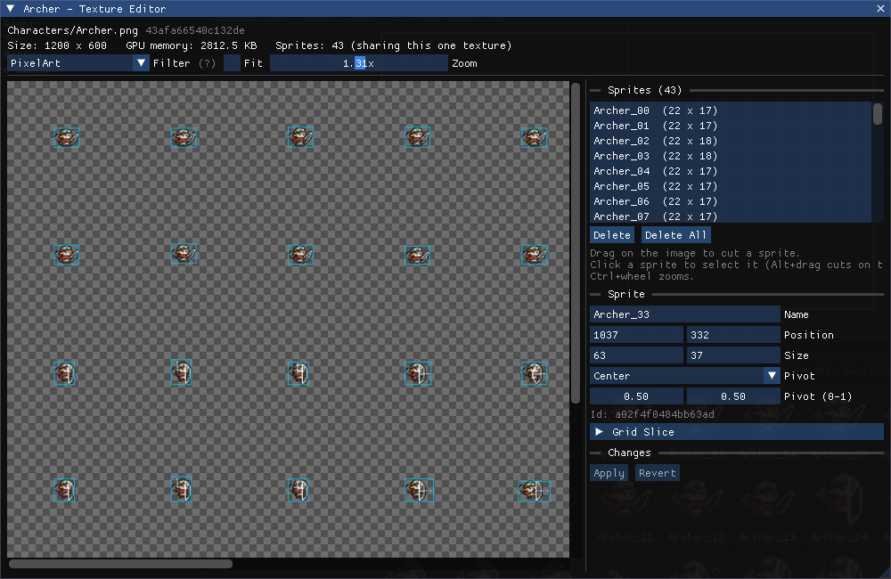
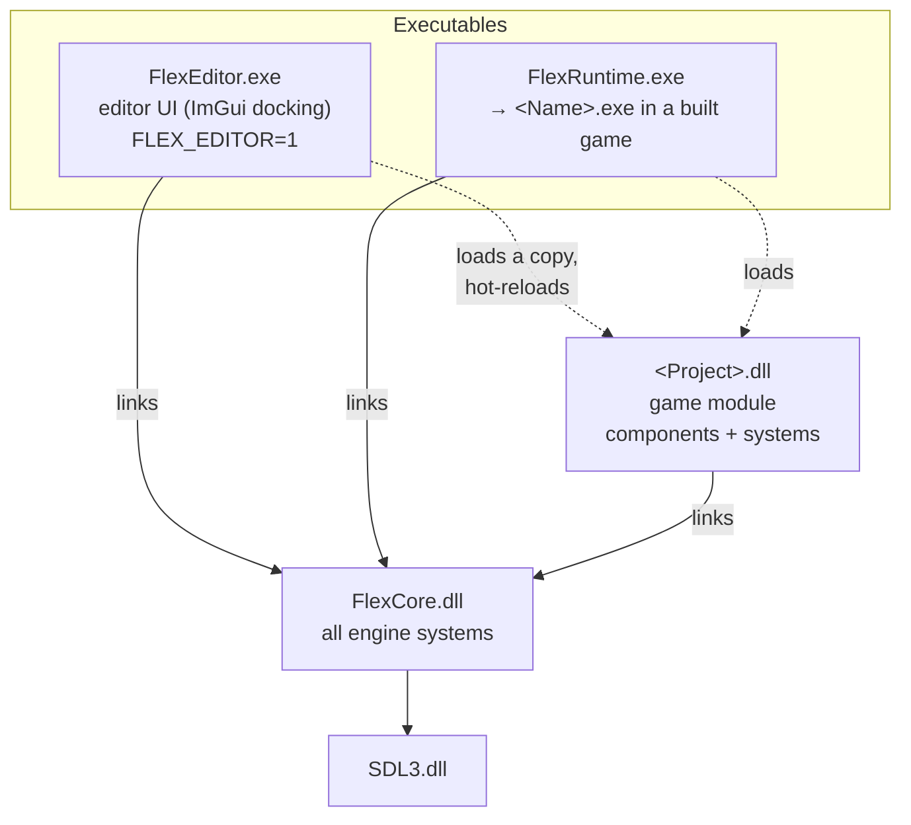
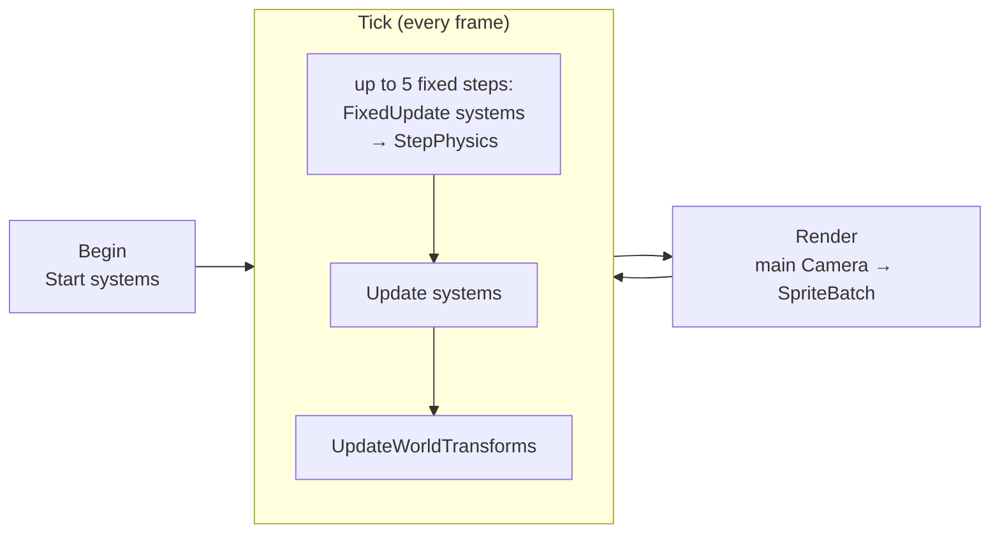

# FlexEngine

A lightweight, flexible **2D game engine** written in C++20, inspired by Godot, Unity and Unreal.

- A standalone **editor** (`FlexEditor.exe`) that opens **projects**, with one editor process per project.
- Games are written in C++ as a **game module** (one DLL per project) that the editor loads, **hot-reloads** and plays.
- The editor **builds** a finished game (`<Name>.exe`, made from `FlexRuntime`) as **Development** (with debug tools) or **Shipping** (without).
- Built on **SDL3** (window, input, rendering) and **Dear ImGui** (docking editor UI).



<sub>The editor with the SpriteStorm sample open: Hierarchy, Viewport (the rectangle is the camera's view, the crosses are the four wall colliders), Inspector, and Project/Output/Content.</sub>

---

## Contents

- [Requirements](#requirements)
- [Building](#building)
- [Quick start](#quick-start)
- [Editor tour](#editor-tour)
- [Writing game code](#writing-game-code)
- [Architecture](#architecture)
- [Performance](#performance)
- [Repository layout](#repository-layout)
- [Conventions](#conventions)

---

## Requirements

- Windows, x64
- **Visual Studio 2026** with the *Desktop development with C++* workload (platform toolset **v145**, C++20)
- Nothing else: SDL3 3.4.18 and Dear ImGui 1.92.9b (docking) are vendored in `Dependencies/`

## Building

Open `FlexEngine.sln` and build. From Git Bash:

```bash
"/c/Program Files/Microsoft Visual Studio/18/Community/MSBuild/Current/Bin/MSBuild.exe" FlexEngine.sln -p:Configuration=Development -p:Platform=x64 -m -v:minimal
```

There are three configurations:

| | Debug | Development | Shipping |
|---|---|---|---|
| Optimised | no | yes | yes |
| Define | `FLEX_DEBUG=1` | `FLEX_DEVELOPMENT=1` | `FLEX_SHIPPING=1` |
| Debug tools (`FLEX_DEBUG_TOOLS`) | on | on | off |
| FlexEditor built | yes | yes | no |
| Runtime console window | yes | yes | no |

- Output: `Binaries/<Config>/` holds all exes and DLLs together, including `SDL3.dll` and the sample's `SpriteStorm.dll`.
- Intermediate files: `Intermediate/<Project>/<Config>/`.
- Both folders are git-ignored.
- **Development** is the configuration to use day to day. Debug is unoptimised and much slower with many entities.

## Quick start

### 1. Open the sample in the editor

Start `Binaries/Development/FlexEditor.exe`. Without arguments it shows the **Project Browser** (new project, open project, recent projects). Open `Samples/SpriteStorm/SpriteStorm.flexproj`, or pass it on the command line:

```bash
Binaries/Development/FlexEditor.exe --project Samples/SpriteStorm/SpriteStorm.flexproj
```

Double-click `Main` in the Content window to open the scene, then press **Play** (or **F5**). The `SpriteSwarm` component spawns 100,000 sprites that spin and bounce off the walls. Press **Stop** (F5) to get the scene back exactly as it was before Play.



<sub>Play mode with *Game View* on: the Viewport shows what the main Camera sees. The toolbar shows fps, the time per game tick, and the sprite and body counts.</sub>

### 2. Run the game standalone

```bash
Binaries/Development/FlexRuntime.exe --project Samples/SpriteStorm/SpriteStorm.flexproj
```

| Argument | Meaning |
|---|---|
| `--project <file.flexproj>` | The project to run. It loads the project's game module and its **Start Scene**. |
| `--scene <file.scene>` | Run this scene instead of the Start Scene. |
| `--benchmark SECONDS` | Run for a fixed time and log the frame timings. |
| *(none)* | Run the single `.flexproj` next to the exe. This is how a built game starts. |

In the editor, **File > Run Standalone** does the same for the saved scene.



### 3. Build a game

**File > Build Project** builds the project as **Development** or **Shipping**. The output goes to `<Output>/<Name>/` (by default `<Project>/Builds/`, which is git-ignored). The build:

1. builds the game module in that configuration;
2. copies `FlexRuntime.exe` as `<Name>.exe`, plus `FlexCore.dll`, `SDL3.dll`, `<Name>.dll`, the `.flexproj` and `Content/`;
3. writes a `.flexbuild` marker. Only a folder with that marker is ever replaced.

The engine's binaries must exist in that configuration, so build `FlexEngine.sln` in Shipping once before making a Shipping build. Progress is shown in the **Output** window. *(Content is still copied as it is. Cooked binary data comes later.)*

---

## Editor tour

The first time a project opens, the editor builds a default layout. Every panel can be toggled in the **Windows** menu, and **Windows > Reset Layout** restores the default. The layout and the open panels are saved per project in `Saved/EditorLayout.ini`, and the last opened scene reopens on the next start.

### Hierarchy

A tree of the scene's GameObjects.
- **Drag** an object onto another to parent it, or onto empty space to make it a root.
- Drag an **asset** from Content onto an object or empty space to create a GameObject that shows it.
- **Right-click** to create an empty child, rename (**F2**), move up/down, unparent or delete (**Del**).

### Viewport

The scene drawn with a grid (red/green axes), every camera's view rectangle, and a cross for GameObjects without a sprite.

| Input | Action |
|---|---|
| Left click / drag | Select / move the selection |
| Right or middle drag | Pan |
| Mouse wheel | Zoom around the mouse |
| `F` | Frame the selection |
| `Del` | Delete the selection |
| Drop a texture or sprite | Create a GameObject at the mouse |

The toolbar holds **Play/Stop** and the **Game View** toggle.

### Inspector



Shows the selected GameObject: its name, then every component that has a `Serialize` function (Transform first). Fields are edited in place:
- `bool` → checkbox, numbers → drag fields, strings → text input
- `Vector2` → one row, `Color` → colour picker
- `Rotation` → shown in degrees
- **asset references** (`Uid`) → a slot with a thumbnail. Click it for a **picker** (search box, thumbnails), or drop an asset from Content. *Typed* asset fields only list and accept the allowed types. For example, `SpriteSwarm::Sheet` only takes Textures.

**Add Component** lists every registered component type, including the game module's. Remove a component with the header's `x` or by right-clicking it.

For a selected **asset** it shows the asset's info, a preview and its import settings.

<br clear="right">

### Entities



Every live entity in the world, **including lightweight entities** that aren't GameObjects (above: the 100,000 spawned sprites while playing).
- One row per **archetype** (component set and count). Filter by component name.
- Open a row to list its entities (clipped, so it stays fast at 100k).
- Select an entity to see and edit its components.

### Content



The folders of the project's `Content/` and their assets as thumbnail tiles.
- Textures can be expanded (▶) to show their **sprites**.
- Click selects (Inspector), double-click opens the asset (a scene opens in the editor, a texture opens the Texture Editor), and tiles can be dragged into the Hierarchy, Viewport or Inspector.
- The **Source (C++)** folder lists the project's scripts. Double-click opens one.

### Texture Editor



One window per texture (double-click a texture, or **Open Editor** in the Inspector).
- Set the **filter** (`PixelArt`, `Nearest`, `Linear`). It's saved and applied at once.
- **Drag** on the image to cut a sprite, click to select one, edit name / rect / pivot, **Ctrl+wheel** to zoom.
- **Grid Slice** cuts a whole sheet. Re-slicing with *Replace* keeps the Id of every sprite whose name stays the same, so references survive.
- Sprite edits stay a working copy until **Apply**. Closing with unapplied edits asks first.

### Output and Project

- **Output** shows every log line (`SDL_Log`) plus the build logs of Recompile and Build Project. Errors are red, warnings yellow.
- **Project** shows the project's settings (name, **Start Scene**) and the game module's status.

### Scenes, undo and Play mode

| | |
|---|---|
| **File > New / Open / Save (Ctrl+S) / Save As** | Scene files. A changed scene asks *Save changes?* before it's replaced or the editor quits. The title bar shows `*` when there are unsaved changes. |
| **Edit > Undo / Redo** (Ctrl+Z, Ctrl+Y / Ctrl+Shift+Z) | Every finished edit is one step (max 100). Undoing back to the saved state makes the scene clean again. |
| **Play / Stop** (F5) | Runs the scene with the game's systems and physics. Stop restores the scene. Saving and undo are off while playing. |
| **File > Run Standalone** | Runs the saved scene in `FlexRuntime.exe`. |

---

## Writing game code

A project's C++ lives in `<Project>/Source/` and is built into `<ProjectName>.dll`. Loading that DLL is all it takes: its components and systems register themselves.

### New Script

**Scripts > New Script...** writes `<Name>.h` and `<Name>.cpp` from one of three templates:

| Template | Creates |
|---|---|
| **Component** | a component struct with `Serialize` and its registration |
| **System** | a system function and its registration |
| **Component + System** | both |

The first time, it also generates `Source/<Name>.vcxproj` and `<Name>.sln`. They contain no absolute paths and are safe to commit. They compile every `.h/.cpp` under `Source/`, and **F5 in Visual Studio** starts the editor on the project. **Scripts > Open in Visual Studio** and **Open Source Folder** are in the same menu.

### Recompile and hot reload

**Scripts > Recompile** (**F7**) builds the module with MSBuild on a background thread, with the log in Output. After a successful build the editor **hot-reloads** the module:
1. it saves the scene as text and unloads the old DLL;
2. it loads a fresh copy of the new DLL;
3. it loads the scene back.

Fields that still exist keep their values, and components the module no longer has are kept as unknown sections. Play is stopped first.

The editor always loads a *copy* of the DLL (from `Saved/ModuleCache/`), so Visual Studio can rebuild the module while the editor runs.

### Components

A component is a plain struct with `FLEX_COMPONENT(Name)`. Give it a `Serialize` function to save it in scene files and edit it in the Inspector. From the sample (`Samples/SpriteStorm/Source/SwarmComponents.h`):

```cpp
struct SpriteSwarm
{
	FLEX_COMPONENT(SpriteSwarm)
	static constexpr uint32_t Version = 1;

	Flex::Uid Sheet;             // a texture with sprites cut from it
	int32_t Count = 10000;
	float MinSpeed = 60.0f;      // units per second
	float MaxSpeed = 260.0f;
	// ...

	void Serialize(Flex::Archive& archive)
	{
		archive.SerializeVersion(Version);
		archive.Field("Sheet", Sheet, { Flex::Texture::TypeName }); // only Textures allowed
		archive.Field("Count", Count);
		archive.Field("MinSpeed", MinSpeed);
		archive.Field("MaxSpeed", MaxSpeed);
		// ...
	}
};

// Runtime-only data: no Serialize, so it's never saved or shown in the Inspector.
struct Spin
{
	FLEX_COMPONENT(Spin)
	float Speed = 0.0f; // radians per second
};
```

Register every component in **one** `.cpp` so it can be found by name before it's first used (Add Component, loading scenes):

```cpp
FLEX_REGISTER_COMPONENT(SpriteSwarm)
FLEX_REGISTER_COMPONENT(Spin)
```

### Systems

A system is a function `void Function(World&, float deltaTime)`, registered for a **phase**:

| Phase | Runs |
|---|---|
| `Start` | once, when the game starts |
| `FixedUpdate` | every fixed step, before physics |
| `Update` | every frame |

From `Samples/SpriteStorm/Source/SwarmSystems.cpp`:

```cpp
// Update: spin everything that has a Spin.
void SpinSprites(World& world, float deltaTime)
{
	world.Each<Transform, const Spin>([deltaTime](Transform& transform, const Spin& spin) {
		transform.Rotation = Math::WrapAngle(transform.Rotation + spin.Speed * deltaTime);
	});
}
FLEX_REGISTER_SYSTEM(Update, SpinSprites)
```

Spawning many lightweight entities at once (from `SpawnSwarms`, a `Start` system):

```cpp
world.SpawnBatch<Transform, WorldTransform, SpriteRenderer, RigidBody2D, CircleCollider2D, Spin>(count,
	[&](Transform& transform, WorldTransform&, SpriteRenderer& renderer, RigidBody2D& body, CircleCollider2D& collider, Spin& spin) {
		transform.Position = { random.Range(inside.x, inside.x + inside.width), random.Range(inside.y, inside.y + inside.height) };
		renderer.AssetId = sprites[next++ % sprites.size()];
		body.Velocity = random.OnUnitCircle() * random.Range(swarm.MinSpeed, swarm.MaxSpeed);
		collider.Radius = swarm.ColliderRadius;
		spin.Speed = random.Range(-swarm.MaxSpin, swarm.MaxSpin);
	});
```

> [!IMPORTANT]
> **Rebuild the game module whenever the engine changes.** Component layouts and other structs cross the DLL boundary, so a module built against an older FlexCore can break. The editor warns when the module is older than `FlexCore.dll`. Press Recompile (F7).

---

## Architecture



**FlexCore.dll** holds every engine system. It's a DLL so the editor, the runtime and the game module share **one copy** of the engine state: the component registry, the asset cache and the renderer. Public classes are exported with `FLEX_API`. FlexCore never uses `FLEX_EDITOR`, because it's shared with the runtime.

### Frame loop: `GameInstance`

The editor's Play mode and FlexRuntime use the same loop (`Core/Game/GameInstance`):



Systems of one phase run sorted by name, and `world.ApplyCommands()` runs after every system.

### ECS world (`Core/World/`)

- **One ECS world with its own archetype storage.** Every GameObject **is** an entity with a `GameObjectInfo` (name, persistent `Uid`). **Lightweight entities** (bullets, units, the 100k sprites) have only data components and are spawned in bulk. The same systems process both.
- **`Entity`** = index + generation (8 bytes). Destroying an entity bumps the generation, so stale handles stop being alive.
- **Components** are identified by **name** through `ComponentRegistery`, so a game DLL gets the same ids as the engine. Ids are never saved; names are.
- **Archetypes:** one table per exact component set, with one contiguous, 64-byte-aligned column per component. Rows are packed with swap-and-pop. Adding or removing a component moves the row, and those moves are cached as edges.
- **Queries:** `world.Each<A, const B>(lambda)`, optionally with `Entity` as the first parameter. It's a header template, so FlexCore is called once per archetype, never per entity.
- **Command buffer:** structural changes are not allowed inside `Each`. Record them with `world.GetCommands()` (`Spawn`, `Destroy`, `AddComponent`, `RemoveComponent`, `Defer`) and they're applied in order by `ApplyCommands()`.

### Transforms, hierarchy and scenes

- `Transform` is **local** (`Position`, `Rotation` in radians, `Scale`). `WorldTransform` (a `Matrix2x3`, world = parent × local) is written by `UpdateWorldTransforms`.
- `Parent` / `Children` components are kept in sync **only** through `Hierarchy::SetParent`, which refuses cycles. The hierarchy belongs to transforms, so lightweight entities can be parented too.
- Coordinates: x right, **y down**. Positive angles turn **clockwise** on screen. 1 unit = 1 pixel at zoom 1.
- `Scene` = a World of GameObjects plus the order of the roots and a Uid → Entity lookup.

### Serialization

Everything inside a project is a readable **text format** (`[Section version=N]`, then `Key = Value`). Loading and saving keeps unknown keys, sections and comments. A scene file:

```ini
[Scene version=1]

[GameObject version=1]
Name = "Camera"
Id = uid(b3563827c5de40bb)

[Transform version=1]
Position.X = 0
Position.Y = 0
Rotation = 0
Scale.X = 1
Scale.Y = 1

[Camera version=1]
ViewSize.X = 1280
ViewSize.Y = 720
```

- A class saves and loads through **one** `Serialize(Archive&)` function, versioned with `SerializeVersion`. Missing fields keep their defaults with a warning, so loading never hard-fails.
- Components of unknown types (for example from a module that isn't loaded) are kept and written back unchanged.
- Exported games will read **cooked binary** data (`BinaryWriter`/`BinaryReader`). Binary is never used for files inside a project.

### Assets

- Every asset file in `Content/` gets a sidecar **`.meta`** file with a random 64-bit **`Uid`**. Assets reference each other **by Uid, never by path**, so files can be moved and renamed. Commit the `.meta` files and move them with their file.
- The editor's `AssetDatabase` scans `Content/`, creates missing `.meta` files, gives copied files new ids, and **never deletes** anything.
- **`AssetManager`** (Core) loads assets by Uid through a pluggable `AssetSource`: source files in the editor and runtime, cooked data later. It shares them (same Uid → same `shared_ptr`) and only keeps weak references, so an asset is freed when its last user lets go.
- **Textures:** `.png` and `.bmp`, loaded by SDL3. Import settings (filter) live in the `.meta`.
- **Sprites** are sub-assets stored in their texture's `.meta` (rect in pixels, pivot 0–1). Any number of sprites share **one** GPU texture.

```ini
[Meta version=1]
Id = uid(43afa66540c132de)
Type = "Texture"

[Import version=1]
Filter = "PixelArt"

[Sprite version=1]
Id = uid(33bb93bbc76364e3)
Name = "Archer_00"
Rect.X = 40
Rect.Y = 40
Rect.Width = 22
Rect.Height = 17
Pivot.X = 0.5
Pivot.Y = 0.5
```

### Rendering

- **`Renderer`** owns the process's single `SDL_Renderer`. GPU resources are created through it, so the backend can change later.
- **`SpriteBatch`** collects textured or solid quads and draws them with `SDL_RenderGeometry`: one draw call per run of quads with the same texture (up to 32,768 quads per call).
- **`SpriteRenderer`** component: `AssetId` (a Sprite or a whole Texture), `Tint`, `Order`. The size is the sprite's pixels times the transform's scale. Sprites are sorted by `Order` (skipped when already in order), and the resolved quad is cached in the component.
- **`Camera`** component: `ViewSize` in world units around the entity, plus a `Background` colour. The main camera (lowest entity index) is fitted to the window with letterboxing.

### Physics (`Core/Physics/`)

- **`RigidBody2D`:** `Static`, `Kinematic` or `Dynamic`, with `Velocity`, `GravityScale`, `Restitution` and `LinearDrag`.
- **Colliders:** `BoxCollider2D` (axis-aligned) and `CircleCollider2D`.
- **`StepPhysics`** runs one fixed step:
  - kinematic bodies move by their velocity;
  - dynamic bodies get gravity (default 980 units/s² down) and drag, then bounce off static colliders.
- Dynamic bodies don't collide with each other yet.
- `Collision2D.h` has header-only helpers (`BounceCircleInsideRect`, `BounceCircleOffRect`, `ClampRectInside`).

### Math (`Core/Math/`)

Header-only and mostly `constexpr`, so it inlines into hot loops in game code: `Vector2`, `Vector2Int`, `Matrix2x3`, `Rect`, `Color`, `Random` (PCG32, seedable) and `MathUtils`.

---

## Performance

Measured on the owner's machine:

| Test | Result |
|---|---|
| **SpriteStorm**: 100,000 sprites, each with a dynamic rigid body and circle collider, spinning and bouncing, Development/Shipping | **~75 fps** (tick ≈ 4.5 ms, render ≈ 6.5 ms) |
| **ECS update**: 50,000 entities, `Position += Velocity * dt` | **~0.04 ms** per frame |
| **ECS churn**: 1,000 destroys + 1,000 spawns via the command buffer | **~0.05 ms** |

The engine's target is 50,000 moving bullets updated *and drawn* at 60 fps in a Development build. SpriteStorm runs twice that number with physics. Debug builds are unoptimised and far slower.

---

## Repository layout

```
FlexEngine/
├── FlexEngine.sln
├── Build/                     FlexConfiguration.props + FlexCommon.props (shared settings)
├── Source/
│   ├── Core/                  → FlexCore.dll
│   │   ├── Assets/            AssetManager, Texture, Sprite, ContentAssetSource
│   │   ├── Game/              GameInstance, GameModule, SystemRegistery
│   │   ├── Graphics/          Renderer, SpriteBatch, SpriteRenderer, Camera
│   │   ├── Math/              Vector2, Matrix2x3, Rect, Color, Random
│   │   ├── Physics/           Physics2D, Collision2D
│   │   ├── Scene/             Scene, SceneSerializer
│   │   ├── Serialization/     Archive, TextDocument, text + binary archives
│   │   └── World/             World, Archetype, Entity, Transform, Hierarchy
│   ├── Editor/                → FlexEditor.exe (ImGui windows, AssetDatabase, scripts, builds)
│   └── Runtime/               → FlexRuntime.exe
├── Samples/
│   └── SpriteStorm/           sample project (SpriteStorm.flexproj, Content/, Source/)
├── Dependencies/              SDL3, Dear ImGui (vendored)
├── Docs/Images/               screenshots for this README
├── Binaries/<Config>/         build output (git-ignored)
└── Intermediate/              intermediate files (git-ignored)
```

A **project** is a folder like this:

```
MyGame/
├── MyGame.flexproj     [Project version=2]: name, Start Scene
├── Content/            assets + their .meta files (commit both)
├── Source/             game code → MyGame.dll (optional)
├── MyGame.sln          generated by New Script (optional)
├── Saved/              per machine: layout, module cache (git-ignored)
├── Binaries/, Intermediate/, Builds/   (git-ignored)
└── .gitignore
```

Project names use letters, digits and `_`, and start with a letter, because the name becomes the game module's name.

## Conventions

- Everything is in `namespace Flex`. Classes, methods and members use PascalCase, and booleans have a `b` prefix (`bIsRunning`).
- Tabs, `#pragma once`, function braces on a new line, control-flow braces on the same line.
- Includes are relative to `Source/`: `#include "Core/World/World.h"`.
- Strings are UTF-8 everywhere. Use `Utf8ToPath` / `PathToUtf8` for `std::filesystem::path`.
- Use `#if FLEX_DEBUG_TOOLS` (not `_DEBUG`) for debug features that should also exist in Development games.
- All modules use the same CRT (`/MDd` Debug, `/MD` otherwise), because STL types cross DLL boundaries. The props files handle this.

The full, detailed documentation of every system is in [`../CLAUDE.md`](../CLAUDE.md).
